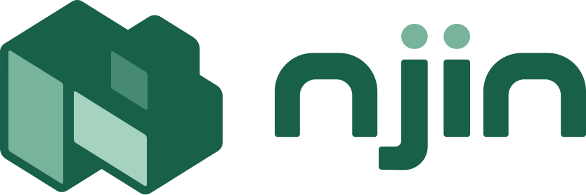

<p align="center">
  <a href="https://njin.run">
    
  </a>
</p>

<p align="center">
  <a href="https://github.com/njinlabs/njin/actions/workflows/ci.yml"></a>
  <a href="https://github.com/njinlabs/njin/actions/workflows/codeql.yml"></a>
  <a href="https://www.npmjs.com/package/@njinlabs/njin"></a>
  <a href="LICENSE"></a>
</p>

## About njin

njin is a framework for company profiles, landing pages and content-driven websites, designed to be used by AI agents as much as by people. You describe your content once, and njin gives you the rest: a REST API, an admin panel and server-rendered pages.

- **Built for AI coding agents.** Every new project comes with a guide that lets an agent such as Claude Code build and change the site without reading the framework's source.
- **Managed by AI agents.** Connect Claude and other MCP clients so they can read and edit content for you, with only the access you approve.
- **One definition, everything else generated.** Models become an API and an admin panel without extra code.
- **An admin panel your team can use.** Edit content, manage files and users, and extend it with your own pages through plugins.
- **Server-rendered pages.** File-based routing, templates, and fast static pages.
- **Drafts, publishing and multiple languages** built in.
- **Access you control.** Groups and permissions decide who can see and change what.
- **Your choice of database.** SurrealDB, PostgreSQL, SQLite, MySQL and MariaDB.

njin is built on [Bun](https://bun.sh).

## Getting Started

Create a project and start it:

```bash
bunx @njinlabs/njin create my-web
cd my-web
bunx njin dev
```

Then open `http://localhost:3000/_admin` to create your first admin.

## Documentation

The documentation lives at **[njin.run/docs](https://njin.run/docs)**.

## Contributing

Thank you for considering contributing to njin! Please read the [contribution guide](CONTRIBUTING.md) first.

## Security Vulnerabilities

If you discover a security vulnerability in njin, please follow the steps in our [security policy](SECURITY.md). Please do not open a public issue.

## License

njin is open-source software licensed under the [MIT license](LICENSE).
